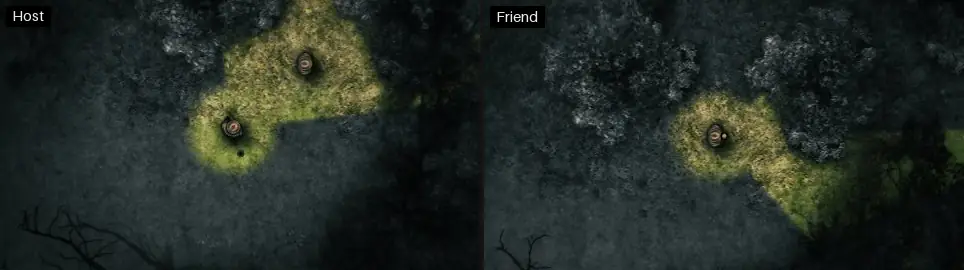
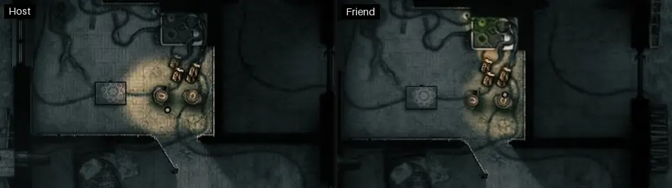
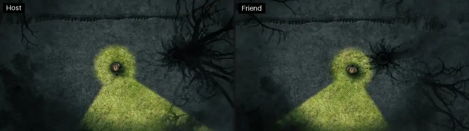
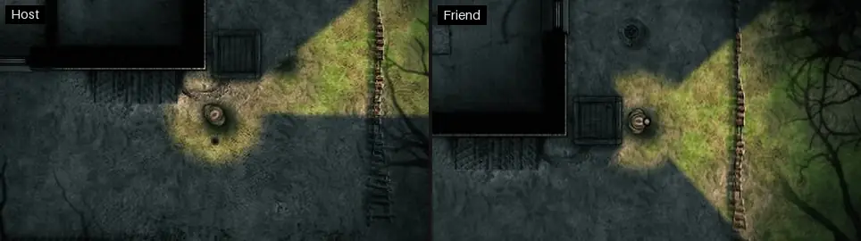
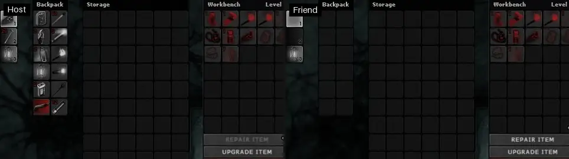
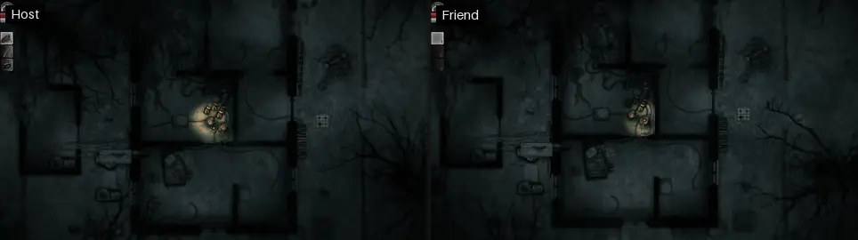

# DarkwoodMP in detail

Everything the mod does, for players who want to know exactly how something works. The [README](../README.md) has the short version.

## Playing

The mod draws the main menu and the pause menu as Half-Life's main menu: the logo in the top left, the entries as a column of words in the lower left in the game's pixel font, over the game's own backdrop, and the game's and the mod's versions in the bottom right corner. The main menu has *Start Game* (the Start Game window, below), **Join Game** (the server browser; the co-op panel opens once a join starts), **Options**, *Credits* and *Quit*. The pause menu has *Resume*, **Multiplayer** (the co-op panel), *Help* (the game's controls pages), **Options**, *Back to main menu* and *Quit*. Leaving a world or quitting asks first, in a small dialog (Enter is Yes, Escape is No). Up and down (or the d-pad) choose an entry and Enter (or A) opens it. The game's own entries are still in the menu, hidden, and the mod's call what they did, so the game's screens open as before, except Options, which is the mod's window. The co-op windows (the panel, the server browser, the address and password dialogs, Options) first open on the right side of the screen; you can move and resize them. The loading screen has no tip along the top; the line under the bar says what's happening.

**Options** replaces the game's options screen, in both menus, with a window in the same style, in tabs:
- *Video*: resolution and full screen (they change at once and ask "Keep these settings?", going back by themselves after 15 seconds), brightness (at once), post-processing, light quality and V-Sync.
- *Audio*: the music and sound volumes (heard at once, kept with Apply).
- *Game*: the language (used after Darkwood starts again, so applying one asks to quit, as the game did), camera zoom, and skipping the studio logo.
- *Controls*: the game's switches (relative controls, the mouse wheel on the hotbar, the controller off, aim assist), and every action with its key, mouse button and controller button. Click a key or mouse button and press the new one; Escape cancels. A key another action had is taken from it, as in the game. Controller buttons are shown but can't be changed (the game doesn't let you either). *Reset to defaults* puts the game's keys back.
- *Multiplayer*: your name, which others see (empty: your Steam name, or your OS user name), and the hosting settings below.

Settings that wait for Apply (post-processing, light quality, V-Sync, camera zoom, language, the volumes) can be put back with *Revert*; closing the window with some still waiting asks whether to apply them. The game's settings are kept where the game keeps them (Unity's PlayerPrefs: the registry on Windows, `~/.config/unity3d/Acid Wizard Studio/Darkwood/prefs` on Linux), so the game behaves as if its own screen had changed them.

The panel and the windows it opens look like Half-Life's and Counter-Strike 1.6's menus in Darkwood's greys and its pixel font: drag a window by its title bar, resize it from the grip in its bottom right corner, and close it with the box at the right of the title bar. Windows stay on the screen, and go back to their default place when the screen size changes. Escape or *Close* shuts them all. While one is open, the game's cursor sprite (which the windows would cover) is hidden and the system cursor takes the game's cursor picture, so it's drawn over them (`GameCursor.cs`).

**Start Game** opens one window in place of the game's profiles screen. First the save: a list of your save slots, each with its slot number, the name you gave it, its day, chapter and difficulty, and who has played it with you ("with Keeper, Bob", or "single-player"), and *New Game* in the first free slot. If every slot is in use, *New Game* asks which save to overwrite (and asks again before it's chosen); that save is deleted when the game starts. A chosen save shows when it was last saved, can be renamed, and can be deleted (asked first). Below that are the game's own new-game settings (difficulty, skip the prologue, backer content), greyed out for a save, where they show what it was started with. Last, *Host a multiplayer game*: tick it and the host settings under it come on: Steam or Direct, your name, and for Direct the server name, port, password and most players, and whether new players start fresh or with a copy of your character. *Start* loads the save, or starts the new game, through the game's own code, and with the box ticked starts hosting once the world has loaded. Who played a save with you is recorded by the host as each player joins (their name and player key), in `BepInEx/config/DarkwoodMP.saves.json` with the saves' names, never in the save folder; a new game in a slot, or deleting it, starts its record afresh (and deletes the characters the host kept for that save's players). A save hosted before this record existed shows the names of the characters the host kept for it.

**Hosting can also start from inside your world:** press Escape and choose *Multiplayer* in the pause menu. Friends get the world you're in, so the main menu only joins (*Join Game*).

**Steam:** in your world, *Host with Steam*, then *Invite Steam friends*. Friends accept the invite, or use *Join Game* in their friends list, even if their game isn't running yet.

**Steam friends** (Steam version only): your Steam rich presence says what you're doing, for example `DarkwoodMP 0.27.0 · Chapter 1, day 3 · Dry Meadow · Hosting, 2/4 players` (or `In the main menu`, `Playing alone`, `In Keeper's game, 2/4 players`). The map part is the area of the map you're in, named as the game's map names it, and is left out inside a separate location. Friends see it in *View game info* on your name in their friends list. The line under your name in the list stays "Darkwood": Steam shows text there only from rich presence tokens that the game's developer uploads to Steamworks, and Darkwood has none, so a mod can't set it. In a Steam lobby, Steam is also told which players are together (`steam_player_group` and its size), so it can group them in friends lists. It's updated every 5 seconds, only when it changed.

**Direct, hosting:** in your world, under *Direct connection*, set a server name, a port (default **27720**), an optional password and the most players, then *Start hosting*. The panel lists the addresses friends can use, each with a *Copy* button. With *Open the port on my router* ticked (the default), the router is asked to forward the port, and the panel says what it answered and shows your internet address from the router. Otherwise the public IP is looked up from api.ipify.org, but only when you click for it.

**Direct, joining:** *Find servers...* opens the server browser. Pick a server and *Connect* (or double-click it); a server with a password asks for it first. *Connect to address...* joins by address without the browser.
- *Favorites* has the servers you added with *Add server...* (`host` or `host:port`) or *Add to favorites*.
- *History* has the servers you joined.
- *LAN* finds the servers on your network.

The columns are a padlock for a password, the server's name, players, its world (day and chapter) and ping; click a heading to sort by it, again to turn the order round. A server your version can't join is greyed out, and the line under the list says why.

**Ports:** the host listens on its port over **TCP** (the game) and over **UDP** on the same number (the browser). For internet play, both must be forwarded on the host's router, or everyone can use a VPN such as Tailscale or ZeroTier.

**Opening the port on the router:** when you start hosting with Direct, the mod asks your router to forward the port, TCP and UDP, to your computer: with UPnP first, then NAT-PMP (Apple's routers and many others). The forward lasts an hour and is renewed every half hour while you host, and it's removed when you stop hosting or quit. Only your own router is asked. The Multiplayer window says what happened:
- *Your router opened port 27720 (TCP and UDP)*: friends can connect on the internet address shown.
- *Your router didn't open the port*: UPnP and NAT-PMP are turned off on the router, or it has neither. Turn UPnP on in the router's settings, or forward the port by hand.
- *Port 27720 is already forwarded to another computer*: pick another port, or change the router's forward.
- *Its internet address is a shared or private one*: there's another NAT in front of your router: your internet provider's (carrier-grade NAT, common on mobile and some fibre connections), or a second router such as the provider's modem. Opening the port on your router doesn't reach you from the internet then. Use Steam or a VPN, or put the modem in bridge mode.
- With NAT-PMP, the router may pick other port numbers than asked. Friends connect to the TCP one shown. If the UDP one differs, their server browsers can't see you over the internet, but joining by address works.

The router agreeing doesn't prove that friends can reach you (your firewall, or a provider that blocks incoming connections, can still stop them), and the mod can't check that from your side. Untick *Open the port on my router* (in the Multiplayer window, the Start Game window or Options) to leave the router alone.

The host's own firewall must allow both ports too. Windows asks the first time. On Fedora:

```
sudo firewall-cmd --permanent --add-port=27720/tcp --add-port=27720/udp && sudo firewall-cmd --reload
```

**Joining:**
- You get the host's world **as it is now**. The host's game saves a snapshot for you, and its own save is left alone. Only the part of the save that changes while you play (`sav.dat`) is saved for it; the map's layout (`savs.dat`, about 9 MB) is copied from the host's own save, as the game itself does when it saves. Reading, hashing and packing (Deflate, which shrinks the save to about a quarter) run on a worker thread. So does writing `sav.dat`: the host's game reads the world into the game's save states in one frame, as its own save does, and a worker thread writes them out as the game would (`World/Saves/SnapshotSave.cs`). The host's game stops only for that reading: 132 ms in the map test, where the game's own save stopped it for 245 to 490 ms. If the worker's write fails, or the map's layout has to be saved too (a new location was added since your last save), the game's own save makes the snapshot, as before; `SnapshotOffThread = false` in the config always uses it.
- Everyone in the game sees "*name* is joining..." as soon as the host lets a joiner's Hello in, then "*name* joined" (or "stopped joining").
- A join can't wait for ever: a download that gets nothing for 10 s asks again for what's missing, and gives up after three tries; a joiner that hears nothing from the host for 60 s stops. Either way the screen goes and the panel says why.
- If you're in a game of your own, you leave it, so save first.
- Going back to the main menu from a host's game leaves it (your character is sent to the host first), so you can join it, or another, straight away. While you're in someone's game, the Multiplayer window still has *Find servers...* and *Connect to address...*: joining another server leaves the one you're in. Tested with a scripted host (back to the main menu, then joining again); switching from one server to another wasn't tried.
- Once the host offers its world, the game's own loading screen comes up (in the main menu, or over your world if you join from the pause menu) and stays until the host's world is playable: one screen and one bar, which the download fills to 30% and the game's loading the rest. A line under the bar says what's happening: connecting, downloading with the MB so far, waiting for the host, then the game's own loading steps (reading the save, placing the saved objects, fitting them together, restoring dreams, the map and events, the state of the world, places and characters, the area around you). The same steps are shown whenever the game loads a world, in single player too, and for a new world its generation steps (laying out the forest, places, roads, objects, paths, characters). Esc stops joining until the world starts loading. If the join fails, the screen goes and the co-op panel opens, saying why. Tested with a scripted host, joining from the main menu; not yet joining from the pause menu.
- While you're in the host's world, your game saves into the mod's cache, never into your own saves. Those are back as soon as you return to the main menu.

**Your character is yours:** the host keeps each player's character (position, health, level, skills, recipes, inventory and hotbar, with their own number of slots) and gives it back whenever they rejoin that world, and into the next chapter. Someone new starts with empty bags, full health and no skills, next to the host, and takes the levels the others have at a stove. A joiner is put where they were saved if no other player or anything solid is there, or else on the nearest free spot around it (around the host, for someone new), on the same side of any wall, and the others only see them once they're there. Players don't bump into each other hard: two players standing in each other are eased apart, gently (`SoftPlayerCollision` in the settings; off, they pass through each other). Walking into another player only slows you down, so nobody can block a doorway.

**Levels and skills:** everyone has the same essence and the same levels; each player picks their own skills. The host keeps the essence: what anyone cooks at a stove fills one shared bar (a joiner's cooking is asked of the host, which refuses it while the bar is full). When the bar is full, the first player to open a stove takes the level; the others then find a full bar at their own stove visit and take the same level. The stove only gives the level and its skill point: the game's own skill choice doesn't open there. Points are spent on the **Skills panel**, opened anywhere with **K** (the `SkillsKey` setting; none of the game's default keys use K). It doesn't open the backpack, but the backpack can be opened beside it with its own key; clicks on the panel don't reach the world, and Escape closes it. Each skill takes the mouse over its whole cell in the grid, so there is no dead space between the icons; a learned skill has a bright frame and a check mark, one chosen to learn a grey frame. It shows your skill points and the game's four tiers with their own icons, names and descriptions; click a skill, and a negative one when the game wants one, then *Learn*. The game's rules hold: a tier opens at its level (I at 1, II at 3, III at 5, IV at 7), takes two skills at most, and the first skill taken from a tier with negative skills comes with one of that tier's negative skills, so each such tier gives one negative skill, as in the game when the levels come one at a time. Several points can be spent one after another in any order without taking more negative skills than that. A joiner's choice is asked of the host, which checks the same rules and that the level isn't more than the shared essence gives; a refused choice is taken back. While the stove's menu is open, a *Levels to take* line says how many are waiting and a *Skill points to spend* line how many points are left. In the morning (from dawn until the first player walks out of their hideout, the same time the morning clock waits for) the stove also shows *Reset skills (mornings, once a day)*: it takes back all your chosen skills (good and negative) and gives back their points to spend again; your levels stay. The host allows it only in that player's morning (their own game says whether they are in it) and once per player per in-game day. Playing alone it works the same way, and the day of the last reset is kept in the same file the host uses (`darkwoodmp_progress.json` beside the save). Tested alone with `--dwmp-solo-test` (the panel opened with its key, a point spent, the same skill again refused, a reset outside the morning refused, one in the morning allowed and a second refused, a full bar at the stove giving a level without the game's choice; screenshots of the panel and the stove), with a scripted player (`host-progress`: the host's checks of points and resets) and in the map test with a real client (`MAP_SCENARIO=map_scenario_skills`). Spending several points in a row is tested by the map step `skills-learn-all` (the host's own and a joiner's, each choice allowed by the host, one negative skill per tier) and, alone, with the real mouse moved and clicked by ydotool on Linux (a skill, its negative skill, *Learn*, for two points). Otherwise the tests choose the skills through the panel's own code, and check the hover with a test mouse position (the map step `skills-panel`: each cell covers its icon, the mouse at an icon's edge and between two icons is over a skill, the window keeps its size, K leaves the backpack shut).

**Level dreams together:** the dreams that come with levels 2, 3, 5, 6 and 7 come with the host's levels. When the host takes one, its game draws the dream as soon as its transition starts, and every joiner goes into the same dream through the game's own transition at the same time (a joiner choosing a skill or talking goes in once that's done). The dream stands in the same place in every game, so you see each other in it. When anyone's dream ends (they die in it, or reach its end), everyone's ends with the same outcome, and a dream that leads into another leads everyone into it. The host's game runs the dream's enemies and events for everyone, as it does a separate location's, so you fight the same enemies (the church dream's chomper comes out once, in every game, and goes for whoever it has the most threat for). A joiner's own levels bring no dream. Dreams from the story or from a kill stay the player's own. Not yet tried in game.

**If things look out of sync:** *Reload the host's world* in the panel saves your character to the host, rejoins and loads the world again. This also happens on its own when the host's world changes (a new chapter, a reloaded save).

**When the host leaves:** if the host goes back to the main menu, the server stops and everyone else goes back to theirs, with the co-op panel open saying why. The same happens if the host quits or their connection breaks: over Direct, a connection that has sent nothing (not even its keepalive, every 3 seconds) for 15 seconds is closed, on both sides; over Steam, when Steam gives up on the connection. Your character is as the host last saved it. If your own connection dropped, join again: the host takes your new connection in place of the old one, so you don't wait for it to time out. After you leave a host's game you're still in your copy of their world (your own saves are untouched); you can't host that copy, so go back to the main menu and load your own world to host.

**The prologue together:** a new game's prologue is played together. Join once the host's intro film is over: you come into the part of the prologue the host is in (the forest, or the dream after it), with that part's own items, beside the host. When anyone reaches the end of a part, everyone goes on into the next one, and at the end everyone wakes at the hideout. Your character is kept from then on (what you carried in the prologue isn't).

**Joining while the host is busy:** while the host's world is loading, the host is watching the prologue's intro film or is between its parts, or the host is in a dream (a place of its own their game loads just for them), you wait, and come in by yourself once they're out.

**The game doesn't pause:** with others in the world, the pause menu, the map, the journal and dialogue stop your own character but not the world. Enemies and the clock go on, and the pause menu shows the world, dimmed, behind it. Playing alone, the pause menu shows the world behind it too (paused, as in the game). Your HUD (the backpack, the hotbar, open containers, the bars and the clock) is hidden under the menu and comes back as it was when you resume.

**Dying for good:** on Nightmare, or on Hard with no lives left, a player who dies while others are still playing watches them instead: the camera follows a living player (click for the next, right-click for the one before), nobody sees the dead player, and enemies ignore them. The view is open all around the player being watched, not the cone the dead character faced when it died. The profile is marked dead, as the game does. A joiner's death for good is kept with their character in the host's world: leaving and coming back doesn't bring it back alive, they watch the others again (or get the permadeath screen if nobody is playing). When nobody is left playing, the game's permadeath screen follows. For a joiner that deletes only their copy of the host's world.

**Notices** appear over your character when someone joins, leaves or dies.

**Descriptions:** many of the game's items show only a name when you point at them (their description is empty in every language), and the map's locations have none. The mod adds a short English line for those, also when playing alone: what the item is, and what the game's data says about it (damage, magazine, ammunition, armour, effects, what it's used to make, what a map marks). A description the game has is never changed. Journal items (notes, keys, photos, drawings) have their own page in the journal and get none. On the map, the location's line comes above the game's "you are here". Item and location names in these lines are the game's own, in your language.

## What's shared

In these clips the host's screen is on the left and a friend's on the right, recorded at the same moment from two games on one computer, with the game's camera zoomed in. Scripted test players act them out in the mod's test world, so they move like test players, not people.

| | |
|---|---|
|  |  |
| **Enemies:** the host's game runs the dog; it goes for the friend, and the friend's hits reach it. | **Doors:** the friend opens and closes a door, and it opens and closes in the host's game. |
|  |  |
| **Thrown things and fire:** the friend's molotov and the host's flare land and burn in both games. | **Dragging:** the friend drags a crate, and the host sees it move. |
|  |  |
| **Workbench:** its storage open in both games; what either player puts in or takes out shows in both windows. | **Joining:** the friend leaves to the main menu, joins from *Join Game* and loads the host's world. |

| | |
|---|---|
| **Players** | Everyone sees everyone, with their look, weapon, clothes and animations (each sprite mirrored), and a name tag with their health (hidden under the pause menu and the mod's menus, in cutscenes, dialogue, the journal and the game's other full-screen menus, but not with just the backpack or a container open). Players in the main world are marked on your map, with their names; a player in a separate location or a dream isn't shown while you're elsewhere. You hear the others (steps, shots, reloads, hammering, pain) where they are, and see their muzzle flashes, their blood when they are hurt and their flames when they burn. A weapon's or torch's frames that your own player never used are loaded when someone else uses them, so their attacks show. A torch or lamp in their hand lights them up, with its flames on the item in their hand (the game moves them for each animation frame and facing; their game sends where), and so does a flashlight's beam (as far and as bright as in their game, which works it out from where their mouse is). A lantern worn on the hotbar lights the area around them in everyone's game, so the host's enemies and shadows see them as lit (`Core.isInLight`). |
| **Enemies** | The host runs every enemy. Friends see the same enemies, with their movement (20 updates a second, each with the host's clock; a friend's game draws them where the host has them now by that clock, between the last two updates or carried on at their speed when the next is late, so updates that come late or in bunches don't make them stop and jump: in the map test, enemies chasing the client stood still in 2.5% of the frames they moved, against 32.5% when drawn by arrival times; they aren't drawn further in the past, which is smoother, because a friend can't walk through an enemy's copy, and a copy drawn 0.1 s or more behind let friends walk into dogs on the host that they'd have kept clear of), animations, sounds and blood, and their own game runs none. Enemies see, chase and hit every player; a friend's hits and weapon effects (bleeding, burning) apply on the host. Areas around every player stay active: around a friend, as much as their own game shows (their screen may be another shape than the host's), also while the host is on a loading screen. A dead enemy's body can be searched in every game: 2 s after it dies, a friend's game runs the game's own end-of-death steps on its copy and holds the last frame (the worms, which have no death animation, stay unsearchable, as in the game). A body stays where it fell in every game, also when the enemy chased someone out of its area first, and a friend's screen doesn't go dark beside it. A friend's game makes no enemies of its own where the host runs the world, and the ones it keeps hidden there make no sound (no barking from a dog camp the host already cleared). What an enemy's projectile leaves where it lands (the human spider's and the swamper's) is the host's, made in every game; the projectile's flight is sent too (EnemyProjectile), but the test never saw one go through that path, so friends may not see it fly. An enemy's shadow armour (the black barrier on some chapter 2 night enemies) shows in every game, also to a friend who joins while it's about; only the host's copy is worn down by light (anyone's) and hits, and it disappears in every game when the host's dies (tested on a Dog given the armour, not on a real night enemy). The two-game map test fights each kind of enemy and animal beside the joiner (`MAP_SCENARIO=map_scenario_enemies`, `EE_FULL=1` for every kind). |
| **Threat** | Enemies don't go for the closest player. Each keeps a threat score per player: damage dealt, the noise they make (steps, running, shots), being seen, and a little for closeness, all fading with a 15 s half-life. It goes for the most threatening player it can see, and only switches for 1.3 times as much. That includes enemies scripted to come "for the player"; closeness counts over at least 1500 for those, so one that sees little or nothing (the immobile infected villagers) faces the player beside it. Dead and dying players aren't targets, nor invisible ones (the Chameleon skill): turning invisible makes the host's enemies stop attacking you. Enemies dodge a friend's swing and get scared by a friend's aim, as they do the host's. A ward (shadow, forest spirit) and the Friend / Enemy of the Forest skills count for the player who has them: the host's enemies read them from that player (shadows that appear around the host still go by the host's ward). |
| **Time** | One clock: the host's. Dusk, night and dawn come for everyone. While the host dreams, the world's clock waits for them, as it does in the game; a dream that ends at a set time sets everyone's clock. A friend's dream keeps its own time, and their clock catches up when they wake. |
| **Nights, events and weather** | The host rolls them and the others follow: the night's scenario, the night events it fires (each player hears and sees it at their own hideout: its sounds, effects and messages; what it changes in the world comes from the host, including the objects its steps make, such as night mushrooms, lights, cockroaches, gore and smoke, which appear in every game where the host's did, and reach a player who joins later), the shadows' lights (the same lamp stays on in every game), the day's random events, the random objects that appear at dawn, night mushrooms, and the rain, lightning and fog. A player away in a separate location or a dream has their own there. |
| **Night attacks** | The host sends the night's attackers at every occupied hideout (the game's own hideout check, run at each player's position), and night worms at every player without a shadow ward. Each occupied hideout gets the attackers one player alone there would: one each spawn interval, and the night's numbers of each kind counted for that hideout. Players who share a hideout share its attackers (three players in one hideout don't get three times as many); a player out of any hideout gets none, as in the game. Tested with c1, c2 and the host in one hideout and c3 in another (`map4_multi`). Enemies that despawn when far from "the player", or run from them, use the nearest player or the one they're after. |
| **Doors and windows** | Opening, closing, barricading, damage, breaking, rebuilding a broken door, locks (the story's, and doors and chests opened with a key or a lockpick), and doors the story keeps shut until something happens (Piotrek's house), which open for everyone once the host's world has seen it happen. An open door's leaf that a player walks into rests at the same angle in everyone's game, and so does the leaf of a door a player opens: it rests where it came to rest in the opener's game. A door opened while it was switched off in your game (far from you) swings open when you come back. |
| **Padlocks and locked crates** | A padlock's code entered by one player opens it for everyone, and its events are shared as scripted events (below). A locked crate picked open by one player is open for everyone; the host rolls whether the pick works. |
| **Traps** | Going off (with sound and effect), disarming, placing (a friend's placed trap is asked of the host, which checks it's within reach, something a player can place, and in the friend's bags: their game sends their character to the host as they begin placing, so a trap picked up a moment before counts; tested both ways in the map test, through the game's own placing). Disarming shows: you crouch over the trap, so others see what you're doing (tested in the map test). |
| **Dragging and pushing** | Furniture and other things a player drags move in everyone's game, and stay where they're left. One player drags a thing at a time: if someone else is already moving it, you let go at once and are told "NAME is moving it" (the host decides who was first). One a player walks into, hits, shoots or blows away (furniture, placed objects, dropped items), however little it moved, slides in everyone's game and ends up where it came to rest in that player's game (the host checks it as it checks a drag). Anything the world moves by itself (settling, explosions, enemies) rests where it did in the host's game; something still sliding when the host saved the world for a joiner is sent to the joiner where it came to rest, once they're in. Other players' puppets, and their stand-ins for the AI on the host, never shove loose things. |
| **Thrown things** | Molotovs, pipe bombs, rocks, flares: thrown in everyone's game, from the same spot towards the same target. The host's copy is the one that hurts its enemies and damages doors, windows and furniture; in a friend's game the throw's explosion and fire only show, and the host's hits arrive. The gasoline a molotov spills is the host's: its game spills it and sends where, a friend's game spills none of its own, so the fire spreads along the same puddles everywhere (tested in the two-game map test). (The two-game map test found a friend's molotov breaking their copy of a barricade twice as fast; the fix is read from the code, not yet re-tested.) A thrown knife or brick lands only in the thrower's game, so it can't be picked up twice. A flare or match dropped at your feet (letting go of aim) is dropped in everyone's game too (read from the code, not tried in game). |
| **Furniture and explosions** | Smashing, shooting or burning furniture and other breakable things: each hit and what it breaks, in everyone's game, and repairs. An exploding barrel or gas bottle that is shot, lit or caught in another explosion goes off for everyone; the host's copy is the one that hurts its enemies and does the damage around it, which reaches the others as hits. Any fire other than a friend's own flamethrower burns things on the host only. A friend's flamethrower hitting a door, window or furniture is sent like a hit. A friend's hit or shot is checked by the host (reach, damage). Cutting a vine, and the shadow covering an item dying (the host decides when), happen in everyone's game too (no test save has either, so not tried in game). |
| **Eggs and infection** | A larva egg broken open (the one with the Embryo inside) is broken in everyone's game, even where it's out of sight; the Embryo is taken once, as from any container. Infection on the ground (the black growth that hurts to walk on, as at the border between the Dry Meadow and the Silent Forest) that a burning weapon or fire clears is cleared for everyone; a friend's burning weapon is checked by the host (reach). New patches (infection spreading, a spider laying) are the host's and appear in everyone's game. (Not yet tried in game.) |
| **Fire** | Burning enemies, doors, windows and furniture burn for everyone. The host's world decides what burns and the damage; the others show the flames and hear them. A friend's flamethrower sets the host's enemies alight, and a door, window or piece of furniture it lights is asked of the host, which lights its own (not yet tried in game). |
| **Enemy explosions, fire and auras** | Enemy bombs and other explosions, enemy flames and enemies' damage auras hurt every player in reach, with the game's falloff, decided by the host; a flier hurts the player it dove at. Friends hear an enemy's explosion and see its flash (the fire it leaves shows only on the host). Tested with a scripted player for a bomb, an aura and a flame; fliers and shooters only read from the code. |
| **Lamps, generators, radios** | Switching on and off. A generator's running sound stops when anyone switches it off, also after a night. Also the switches shown in their own window (`InteractiveItem`; none in the test world, so not tried in game). |
| **Feeders** | One feed a day for everyone: the first player to use it gets it, and it's empty for the others until dawn. A friend's use waits for the host's yes. |
| **Fuel** | Fuel poured into a generator or the saw, and the saw's fuel used for each log it cuts. Pours add up: when two players pour into the same generator at once, both count. A pour into a full tank is refused, and what didn't fit goes back into your can. Only the host burns a running generator's fuel, by the electrician skill of the player nearest it; the others are sent its amount every few seconds when it changed. |
| **Containers** | Cupboards, crates, corpses, items on the ground, traders' stock: what one player takes is gone for everyone. One player at a time can have a container open; anyone else is told who's using it, and what they took in the same moment is given back (tested with three players taking one slot at once: one gets it). A container is watched from the moment it opens. An open container, workbench, saw or generator window shows what the others change in it as it happens (the slots, the fuel, the recipes you can make), and a container opened by anyone is marked searched for everyone. A container that goes while you have it open (a corpse removed by the host) closes its window. |
| **Workbench** | Its storage is used by everyone at once, slot by slot. A joiner gets the host's contents as they open it (and for every workbench once their world has loaded), so what was put in before they joined is there. If two players change the same slot at the same moment, the host keeps the first change and undoes the second for that player (with everything else that player changed in the same moment, so an item moved between two slots is never doubled): what they put in goes back into their bags (at their feet only if there's no room), what they took is taken back. Upgrades raise the workbench's level for everyone, and an open workbench shows the new level at once. Each level above the first adds a row of six slots to the storage (also without co-op), in everyone's game at once; what's in the extra rows is saved with the world. When the rows wouldn't fit on the screen, the storage window is drawn smaller. A world saved before you installed the mod gets its rows when it loads. A *Sort & Stack* button under the storage (also without co-op) merges partial stacks of the same stackable item up to its stack size (their durability averaged, as the game does when it stacks food) and puts the items in order: by the game's category, then item type, fullest first. Gasoline cans are poured into each other, as when you drop one can on another, so you're left with full cans and at most one part-full one; a can poured empty is gone. Lanterns are topped up from each other the same way, but an empty lantern is kept. Weapons, items holding ammo and upgraded items are moved, never merged. In co-op the host sorts its own storage and sends everyone the slots; a joiner's sort is shown at once and corrected by the host's slots if they differ. |
| **Things made while playing** | Dropped items (also picked up with a click), placed traps, gasoline poured on the ground (and where it was lit), the bag a player drops when they die, the loot of the host's enemies. Notes picked up off the ground, and lures the host's animals eat, are gone for everyone. |
| **Traders** | Trades, and what they have: stocking up (when they appear and each new day) is done by the host, and the others get the host's stock, by the trader's name (traders who share a name, such as the wolfmen at the camps, each keep their own). After an accepted trade the trader's new stock goes to everyone (what the player got and gave stays theirs); a friend's trade is checked by the host (near the trader, he had what they took, the new stock adds up), and if refused the friend gets the host's stock back and their own items as they were. A reputation change shows at once in an open trade window. When a friend's morning trader appears in their hideout and the host has none (it wasn't in a hideout at dawn), the host puts its own copy there, rolls his stock and checks their trades against it; it goes when no friend is in a morning any more. The morning trader leaves everyone's game as soon as the first player walks out of their hideout (an open trade with him closes first, and what was on the table goes back); a friend whose morning starts after that, such as one who joined late, has theirs ended too. |
| **The porter whistle** | Blown at a hideout in the daytime, it calls the porter there in everyone's game. A friend's whistle is asked of the host, which checks the time, that the porter isn't on the way or dead, and that the friend is at that hideout (tested in the map test). |
| **Scripted events** | What a player sets off by walking into a place, using or opening something, a padlock, or a dialogue's outcome. The steps that are the player's own (a dialogue, a dream, being moved, items given, camera, messages, journal, and anything done to the player, such as diving under water) run only for them; doors and switches run on the host and reach everyone from there; the rest (objects shown, hidden or moved, sounds, animations, flags, chained events) runs in every game. A joiner's is asked of the host, which checks it hasn't happened yet and that they're near; the joiner's game runs it only once the host agrees (so a refused one never ran there), and it's then marked as happened for everyone, so it doesn't happen again for the next player; but a trip in it (through a hole, down a ladder), its messages and ordinary items given still come to each other player once when they set it off, also to one who joined after it happened or after the world was loaded again. The same goes for what happens when a player opens or closes a door, switches something on or off, disarms a trap or hits a character: it's that player's event, whichever game the door or the character is run in. A place's mood when you walk into it (the darkness and tint over the Dry Meadow's markings, its whispers, its particles) is only yours: it doesn't reach the others' screens. Leaving a place undoes what entering it started in everyone's game, except for a player who is still in that place, whose game undoes it when they leave too. What the world sets off by itself (at a time of day, a saved thing appearing for the first time, something dying, an item turned on) happens in the host's world and is sent from there: joiners run its world part, and see its messages if they're near it; a dialogue, an item or a trip in it is the host's player's, or the joiner's who caused it (killed the NPC, broke the thing, switched on the machine). Something seen happens for whoever sees it, and is shared only if it happens once. A world location's own enter and exit events go by who is there: the host's game keeps a friend's area running, but a place only a friend is at gives the host's player no message, dialogue or item, and the host's player gets its own part when it arrives; the world's part (a trader, porter or wolf leaving) happens when the last player has gone. |
| **Diving (chapter 2)** | The village cellar's underwater passages need a full oxygen tank. Once any player has held a full tank (refilled at the compressor), every player can dive, without a tank of their own, as often as they like, and it stays so in the saved world. Each player gets the first dive's dream once (but a player who joins, or a world reloaded, after someone else had it skips it). Diving moves only the player who dives, and only the diver hears its splash. |
| **Building and repairing** | A repaired stove or generator, a built option, an enabled feeder: built for everyone (the others' copies take no ingredients). A joiner's build is asked of the host: the ingredients go at once, the thing is built once the host agrees, and if it refuses the ingredients come back and nothing was built. |
| **Dialogue** | One player at a time talks to an NPC; anyone else is told who's talking, and their dialogue closes. |
| **The story** | Quest flags, each NPC's state (reputation, wanting to talk...), dialogue progress; an NPC that dies in one game dies in all of them, and its corpse lies there for everyone to search, what it carried taken once (a friend's kill is checked by the host: the NPC, by name and place, near them; a dead state that didn't come with such a kill is refused). Where NPCs stand is the host's: those that walk (followers, scripted moves) are moved in the others' games to where the host's are. Which of the game's one-time hints (secondary attack, map, active skill, reload) a player has seen is kept by each game for its own player and not shared; a joiner starts with the host's, from the host's save. |
| **The journal** | Story entries, notes read, keys and quest items found, places found on the map and the directions to them: anyone's new entry is added for everyone (a place found, also by reading a map item, is shown on everyone's map too), with the game's "journal updated" popup. A popup shows the game's own name for what was found; something the game has no name for (some small places) and a place the game finds quietly get no popup, in anyone's game, so a raw name like "place_10" never shows. What a player finds in a dream of their own stays theirs; in a dream dreamt together (the prologue, the level dreams) it's shared, so a key found there opens its door for everyone, and it's gone from every journal when the dream ends, as in the game. |
| **Death** | You wake up at home and your bag stays where you fell, for anyone to loot. A friend's death never resets the world. The host's doesn't either while others are playing, so nobody's fight gets yanked away. |
| **Chapters and the end** | A new chapter is the host's: whoever sets it off (a joiner's trigger is asked of the host, which checks they're near and it hasn't happened; if the host is in a dream of its own or still loading just then, its game starts the chapter as soon as it can, and the joiner is told so), the host's game builds it, and everyone loads it once it's ready. Each joiner keeps their character (level, skills, items), as the game carries the host's over, and starts the chapter beside the host. When the host's game reaches the end, everyone plays the epilogue together: the joiners go into it with the host, and whoever moves on to its next part takes everyone along (the story is the host's, so the outcomes are too). The ending is chosen once for everyone: when one player sets the Being on fire in the crater, the fire starts in every game ("<name> set the Being on fire"), and the other ending, going back to sleep, is a move to the next part, which takes everyone too. In the burning forest a player who has crawled to their death watches the ones still crawling, and the camera pans over the burning forest in every game once all of them have, or a minute after the first did. The outcomes screen shows the host's ending. Name tags are hidden in the epilogue, and a joiner starts each part beside the others. Nobody new can join while it plays, and a world that is already in the epilogue (a save made at its start) can't be hosted. If the host leaves during it, the epilogue goes on in your game alone, and the co-op panel opens at the main menu after the credits. When the host's game goes to the credits, everyone's does, and the credits take everyone to the main menu. |
| **Separate places** | A separate location (a cave, an interior) is in the same place in every game: the host decides where it stands, and loads it too when a joiner goes there, so its doors and containers are shared like the world's, and the host's game runs its enemies for the joiners in it, whether or not the host is there. Players in the same location see each other. What a location's events change in the world reaches everyone, also players who have never been there (going through the hole in the village's fence opens the shortcut from the farm for all). Dreams are each player's own, except the level dreams, which everyone dreams together and the host runs (above). While the host is in one, the world around the others keeps running, and new players wait to join until the host is back. |

## Settings

`BepInEx/config/com.darkwoodmp.coop.cfg`. Your name, the hosting settings and `SkipIntro` are also in Options (*Multiplayer* and *Game*):

| Section | Setting | Default | What it does |
|---|---|---|---|
| General | `SkipIntro` | `true` | Starts without the studio logo, so the main menu is up about 6 seconds sooner |
| General | `SoftPlayerCollision` | `true` | Players standing in each other are eased apart, gently. Off: players pass through each other |
| General | `SkillsKey` | `K` | The key that opens and closes the Skills panel (a Unity `KeyCode` name, e.g. `N`) |
| General | `PlayerName` | (empty) | Your name for others. Empty means your Steam name, or your OS user name |
| Host | `ServerName`, `Port`, `Password`, `MaxPlayers` | Darkwood, 27720, (none), 5 | Your Direct server |
| Host | `OpenPort` | `true` | When hosting with Direct, ask the router to forward the port (UPnP or NAT-PMP), and remove it when you stop. `false` leaves the router alone |
| Host | `LiveWorld` | `true` | Joiners get the world as it is now. `false` sends your last save |
| Host | `SnapshotOffThread` | `true` | The snapshot for a joiner is written on a worker thread, so your game stops only while the world is read |
| Host | `NewCharacters` | `fresh` | Someone new starts `fresh` (no items, beside you) or as a `copy` of your character |
| Host | `StackSize` | 50 | How many of an item one slot holds, for every item that stacks (the game's own sizes run from 2 to 50; bigger ones keep theirs). `0` keeps the game's sizes. Players in your game use yours, and it applies at once. Weapons, notes, keys and gasoline and the lantern (whose fuel isn't counted in stacks) are left alone. Saves keep only the amounts, so a world with big stacks still loads with the setting at 0 |
| Network | `SendRate` | 20 | Player updates per second |
| Debug | `LogPlayerSprites` | `false` | Logs the player's sprites once |

## Files

| File | |
|---|---|
| `BepInEx/plugins/DarkwoodMP/` | The mod: `DarkwoodMP.dll` and `DarkwoodMP.Core.dll`. Both must be from the same version, so update by extracting the whole zip. |
| `BepInEx/config/DarkwoodMP.player.key` | Your player key: there are no accounts, and hosts know you by it. Keep it secret; copy it to another PC to be the same player there. |
| `BepInEx/config/DarkwoodMP.servers.ini` | The browser's Favorites and History, in goasis's format |
| `BepInEx/cache/DarkwoodMP/worlds/<hash>/` | Hosts' worlds you've joined (the last three) |
| `BepInEx/cache/DarkwoodMP/host-snapshot/` | The snapshot of your world for the last joiner |
| `BepInEx/cache/DarkwoodMP/testworld/` | The test world: a copy of your saves, and `darkwoodmp-testarea.txt` (where its test area is) |
| `<your save>/prof<N>/darkwoodmp_players/` | The characters of players who joined that world. Written when your game saves. |
| `<your save>/prof<N>/darkwoodmp_progress.json` | The shared essence and level of that world, and the day of each player's last skill reset. Written when your game saves. |

## Troubleshooting

- **Linux: the game doesn't start from Steam.** Check the launch options say `./darkwood_mp.sh %command%`.
- **The main menu has no Join Game (it shows the game's own entries).** Look in `BepInEx/LogOutput.log` for `DarkwoodMP ... loaded`. If it says some patches were skipped, the game build differs from the one the mod was made for (a game update, or the GOG build); what those patches do won't be shared. If the log says "DarkwoodMP can't start", `DarkwoodMP.Core.dll` is missing or from another version: extract the whole zip over the game folder again.
- **"No answer" when joining by address.** The host's router must forward the port (TCP and UDP), and its firewall must allow it. On a LAN, check the host's firewall first. Over the internet, read what the host's Multiplayer window says about the router (see *Opening the port on the router*).
- **Refused: "different DarkwoodMP version".** Everyone needs a mod version with the same protocol (see the release notes).
- **A Steam join stops partway through the world download.** Fixed in 0.11.1: only the host needs it.
- **Refused: "isn't in a saved game yet".** The host has to be in their world, not the menu.
- **"The host is watching the prologue's intro" (or "between parts of the prologue", "in a dream", or "away in another place").** Wait: you join by yourself when they're out of it.
- **"The host is playing the ending."** Nobody can join while the host plays the epilogue (it ends at the credits); join after it.
- **The LAN tab finds nothing.** The search asks the broadcast address first (a host answering it shows at once), then every address on your /24 on port 27720 (that can take ten seconds, with hosts showing as they answer), so the host's firewall must let UDP 27720 in. A host on another port is found by broadcast only, which Windows' firewall may block: add it under *Add server* instead.
- **The whole screen goes black in one spot and comes back when you step away.** The game switches your view off while something solid is under your character. Please report it with your `LogOutput.log`: the mod logs a `[view]` line there naming what it was.
- Logs: `BepInEx/LogOutput.log` (the mod), and Unity's `Player.log` (`~/.config/unity3d/Acid Wizard Studio/Darkwood/` on Linux, `%USERPROFILE%\AppData\LocalLow\Acid Wizard Studio\Darkwood\` on Windows).

## Known limitations

[INTERACTIONS.md](INTERACTIONS.md) lists what the game does, what the mod shares, and the known gaps ranked by what two players would notice first (read from the game's code; most rows not yet checked in game). Besides those, these are known:

- The mod is built and tested against Darkwood 1.4 (Unity 2021.3.30f1). It patches the game's own code, so a later game update can break parts of it until the mod is updated.
- NPCs run in each player's game; the host sends where its NPCs stand (twice a second for those that moved), and the others' copies are kept there, also for an NPC in a part of the host's world it has switched off. A follower follows the player whose event made it one (a joiner's dialogue or scripted step, which the host runs as theirs): the host's copy goes after that joiner's stand-in, and the others' copies go with it. Followers the host recruited, or that follow from the start, follow the host's player. The host doesn't save who recruited a follower: after the host reloads, or once that joiner has left, it follows the host's player again. The morning trader and the wolf, which each game puts in its own player's hideout, aren't moved (they are matched by name). Their stock, their state and their deaths are shared. An NPC that turns hostile (a player hits it, or a dialogue's outcome or a scripted attack sends it after one) is run by the host as one of its enemies until it calms down: it picks a player by threat, every player sees the host's copy fight, and every player's hits go into its one health. A joiner's hit or scripted attack on a friendly NPC goes to the host, whose copy turns on that joiner; an NPC only the joiner's game has (a hideout's own wolf or trader) stays theirs. The morning trader or wolf appears at each player's own hideout (one player talks to him at a time); the trader leaves everyone's game when the host's morning ends (a joiner talking or trading with him, or with the wolf, then has the trade and dialogue closed first, with what they put on the table given back; the wolf himself stays). Something an NPC's or creature's animation sets off in the story (the musician hiding under the tractor, after which you talk to him there) happens in the host's world and is sent to everyone. A dialogue whose NPC is destroyed or switched off while it is open is closed and the controls given back, and Escape closes it too (the game itself could no longer close it). The host's clock stays stopped in its morning only while every joiner is in a hideout too.
- Objects the world makes after you joined (a location's characters, a delayed event's spawn, the morning trader) get different save IDs in each game, so the host gives each one an ID of its own and sends it with the object's name and position; a joiner's game ties it to its own copy if that one appeared within 30 seconds of the host's and within 50 units of it. A copy that appeared later or further away than that is still named by name and position, so changes to it reach the others only if it stands in the same place in their game.
- A banshee a joiner looks at goes for that joiner, and the forest spirit doesn't jump next to its target while any player sees it or is near it; the host judges what a joiner sees from where they stand and face (it has no view of their screen). Joiners get the banshee's overlay and shake when they see one, its scream (shake, lights out), the forest spirit's effect and combat music. Some other scripted enemy behaviour still follows the host's player only. (Read from the code: no test has a banshee or a forest spirit near a joiner.)
- Night events fire only while the host is at a location (as the game fires them for its one player); each joiner then hears and sees them at their own. The day's redneck ambush can be any player's who is outdoors and away from any location (read from the code, not tried in game).
- Joining a game in progress sends the whole world (about 12 MB, about 3 MB packed), and the host's game still stops while the world is read for the snapshot (about 130 ms on the test world; every object in the world is read in one frame, so that the joiner gets one moment of it).
- If two players change the same story flag at the same moment, the last change wins.
- Scripted events the world sets off by itself are the host's, and a joiner sees only their world part (and the messages if near): a dialogue, an item or a trip somewhere in one goes to the host's player, unless a joiner caused it (killed the NPC, broke the thing or switched on the machine that sets it off), in which case it goes to that joiner. What a joiner does in a place only they are in (a dream of their own, such as a story dream or the night trader's, or a separate location the host didn't place) is theirs alone, as in single player: its events, doors, containers and traps run in their game only and aren't sent to the host. Events that fire whenever a thing comes into view, or that belong to things made while playing, still run in each game separately. A joiner's own event or build waits one round trip for the host's answer before anything of it happens.
- A client's own character (health, what it carries, skills) is kept by its own game, as a prediction the host doesn't check; the host checks what crosses between it and the world (containers, hits, actions). Damage a client takes from the host's enemies is the host's.
- In the epilogue each game runs its own copy of the epilogue's places and their scripted scenes; the players are taken from part to part together, but what happens inside a part (the scenes, the crawl through the burning forest) plays out in each game by itself (only the Being set on fire and the pan over the burning forest are shared), and everyone changes clothes, lights the flat's rooms and pets the dog in their own game; the outcomes screen uses the host's ending (the credits follow the host's). A joiner whose game can't go into the epilogue within 30 seconds (still in a dream, loading) leaves and sees the end screen instead. A real chapter change and a real epilogue (from the end of chapter 2) were tried only with scripted players; see [INTERACTIONS.md](INTERACTIONS.md), gap 26.
- Nightmare and hard-mode permadeath work as in single player, in each player's own game.
- Opening the port on the router works only with a router that has UPnP or NAT-PMP turned on, for IPv4, and can't get past a second NAT (your provider's, or a modem in front of your router). It was tested against a scripted router; on a real router, only finding the router has been tried so far. If the game is killed while hosting, a router that took only a permanent forward keeps it until you remove it in the router's settings, or host and stop hosting again.
